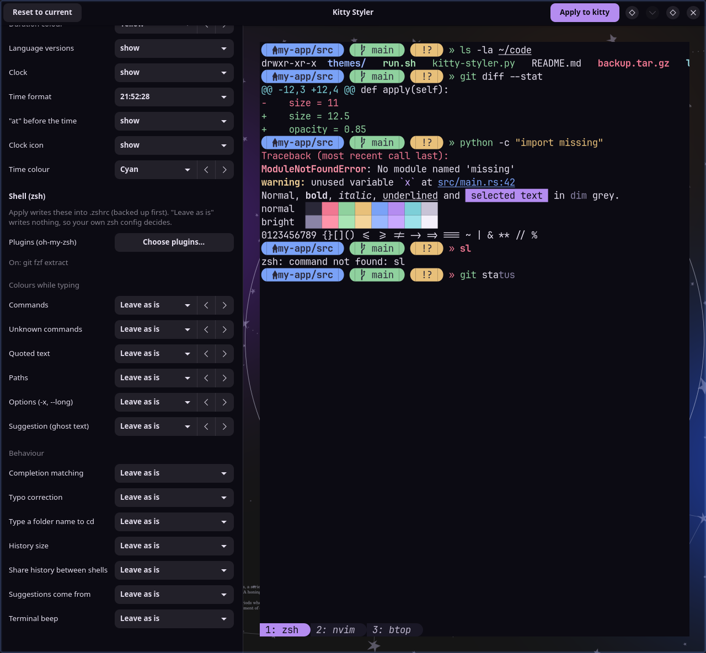

# Shellac

A small GTK4 app for picking how your terminal looks: theme, fonts, window, cursor and, in
[kitty](https://sw.kovidgoyal.net/kitty/), also cursor trails, tab bar, scrollbar and effects. It styles
your prompt too (your own, or a [starship](https://starship.rs/) prompt styled here) and, with zsh, the
shell itself (oh-my-zsh plugins, typing colours, behaviour). Every change shows up in a live preview before
anything is written.

Shellac works with **kitty**, **[Alacritty](https://alacritty.org/)**, **[foot](https://codeberg.org/dnkl/foot)**
and **[Ghostty](https://ghostty.org/)**. It was called Kitty Styler until 1.4.0, when it learned the other
three.


## Terminals

Pick the terminal at the top of the window; only the ones installed (or with a config file) are listed.
Shellac remembers the choice. Rows a terminal doesn't have are hidden, and the preview leaves out what
it can't do (tabs, splits and the scrollbar outside kitty).

| | kitty | Alacritty | foot | Ghostty |
| --- | --- | --- | --- | --- |
| Theme, font, size, bold/italic fonts | yes | yes | yes | yes |
| Line height, letter spacing | yes | | | yes |
| Opacity, padding, title bar | yes | yes | yes | yes |
| Cursor shape and blink | yes | yes | yes | yes |
| Cursor when unfocused | yes | yes | yes | |
| Beam/underline thickness | yes | | yes | |
| Margin, borders, ligatures, inactive windows | yes | | | |
| Cursor trail, effects, tab bar, scrollbar | yes | | | |
| Open windows update on Apply | yes | yes | new windows only | yes |
| Try in a test window | yes | | | |

The prompt and shell sections are the same for every terminal. starship's colour palette only follows a
theme picked for kitty, since all terminals share one starship.toml.

## Features

- **Themes**: all of kitty's own theme collection (used for every terminal), with a search box and
  previous/next buttons.
- **Kitty settings** (the other terminals get the rows they have), grouped under headings:
  - **Text**: font and size, bold and italic fonts, ligatures, line height, letter spacing.
  - **Window**: background opacity, padding, margin, borders and their corners, faded text in inactive
    windows, title bar, and kitty's built-in effects (dim inactive windows, focus highlight, tab change,
    CRT, matrix and more).
  - **Cursor**: shape (also when unfocused), beam and underline thickness, blink, and the cursor trail with
    its style (plain, blaze, lightning, motion blur), speed, start distance and colour.
  - **Tab bar**: position, alignment, style, when it shows, margins and the active/inactive tab text style.
  - **Scrollbar**: when it shows, width, handle opacity, corners and colour, track opacity.
- **Installs what options need**: trail styles and effects need kitty's shader compiler (`slangc`), and
  prompt styling needs starship. If one is missing, the option's note gets an **Install** button (see
  [Extras](#extras)).
- **Live preview**: a mock terminal with a prompt, `ls`, a diff, an error, all 16 colours and the tab bar,
  drawn on your wallpaper when it can find one, so opacity is visible. The prompt is your real one: the
  app asks your shell (or starship) to draw it in the background, so Powerlevel10k, oh-my-zsh themes,
  fish and bash prompts show as they really look, including the error state. A second, inactive window
  split off below shows borders, corners, margin and padding, faded text and the unfocused cursor. The
  preview also draws the bold and italic fonts, ligatures, the scrollbar, cursor blinking and the cursor
  trail, with look-alikes of its blaze, lightning and motion blur styles. It adds example lines for the
  zsh behaviour options you set. Only shader effects and the title bar on tiling compositors (which draw
  none) are left out.
- **Try in kitty**: opens a real kitty window with the settings as they are in the app, shader effects
  and trail styles included, without saving anything. It runs Apply on temporary copies of your
  kitty.conf, starship.toml and shell config, and the copies are deleted when the window closes.
- **Share codes**: **Share…** copies everything picked in the app as one code to send to a friend (or
  saves it to a file, for chat apps that turn long messages into files anyway), and loads a code someone
  sent you, pasted or from the file, into the app, so both kitty windows end up looking the same. The code
  carries the kitty options, the theme's exact colours (also Noctalia's wallpaper colours, as a fixed
  "Shared:" theme), the prompt with the starship.toml it uses, and the shell settings and plugins. Nothing
  changes until you press Apply, and Apply backs up what it replaces. Before loading, it lists what your
  PC doesn't have (a font or plugin, or this kitty version lacking an option) and keeps your own setting
  for those, and it offers to install `slangc` or starship when the code needs them. Parts of a
  starship.toml that run programs (`[custom]` modules, `commands`, `*_binary`) are left out unless you
  tick them. A code only sets values the app offers itself, so it can't slip anything else into your
  config files. Not shared: fonts and oh-my-zsh plugins themselves, zsh options left at "Leave as is", and
  kitty options the app doesn't list. Codes use only letters and digits, so chat apps can't mangle them.
- **Prompt**: keep your own prompt, switch the shell to starship with your own `starship.toml`, or style
  starship here: segment styles (plain, bubbles, arrows, slanted, blocks), one or two lines, and per-part
  colours for the OS icon, user and host, folder, git, error code, duration, language versions and clock.
- **Works with the shell your terminal starts**: its shell setting, else your login shell. zsh, fish
  and bash are supported; the app edits that shell's own config file.
- **Shell (zsh, optional)**: tick [oh-my-zsh](https://ohmyz.sh/) plugins from a searchable list that
  shows what each one does and the aliases it adds; pick the colours
  [zsh-syntax-highlighting](https://github.com/zsh-users/zsh-syntax-highlighting) and
  [zsh-autosuggestions](https://github.com/zsh-users/zsh-autosuggestions) use while you type; and set
  completion case, typo correction, auto cd, history size, shared history and the terminal beep. Every
  option starts at "Leave as is". Rows only show for the parts your shell actually loads.
- **Noctalia (optional)**: if [Noctalia](https://github.com/noctalia-dev/noctalia) manages your terminal's
  colours, the first theme entry follows its wallpaper colours, and the app works alongside Noctalia's
  templates for all four terminals.



## What it changes

Every terminal: settings already in its config file are edited in place, the rest go where they win over
the file, and nothing is written if the terminal's own check rejects the result. Before each Apply the
config file is copied to `<file>.bak-<date>-<time>`; the newest 5 are kept.

### kitty

- **kitty.conf**: settings already in the file are edited in place. New ones go into a block at the end,
  between `# BEGIN_KITTY_STYLER` and `# END_KITTY_STYLER`. That block is rebuilt on every Apply, so put
  your own settings outside it. Open kitty windows reload straight away.
- **Theme**: a picked theme is saved to `themes/kitty-styler.conf` next to kitty.conf and included from the
  block. Pick "Keep current theme" to drop it and go back to your own colours.
- **Effects and trail styles** are names in kitty's `custom_shaders` setting. Apply swaps only the
  effect and trail style picked in the app and keeps any other names in the list.
- Settings that only your theme sets (for example Noctalia's `cursor_trail_color`) are not copied into
  kitty.conf unless you change them, so they keep following the theme.

### Alacritty

- **alacritty.toml**: settings it already has are edited in place, keeping its formatting. New ones go in
  `shellac.toml` next to it, added to `[general] import` (one path per line). Alacritty reloads by itself.
- **Theme**: the colours go in `shellac.toml` too. Settings in alacritty.toml itself win over its imports,
  so while a theme is picked, alacritty.toml's `[colors]` tables wait in `alacritty-colors.shellac.toml`
  (also imported, before `shellac.toml`). Picking the first theme entry puts them back unchanged.
- Settings Shellac can't express exactly (different x and y padding, `blinking = "Never"`, transparent
  decorations) are left alone unless you change that row.

### foot

- **foot.ini**: settings it already has are edited in place (a font's other options and fallback fonts are
  kept). New ones go in a block at the end, between `# BEGIN_KITTY_STYLER` and `# END_KITTY_STYLER`.
- **Theme**: saved as `shellac.ini` next to foot.ini and included from that block.
- foot reads its config when a window opens, so open windows keep theirs; new ones get the changes.
  `foot --check-config` has to accept the result first.

### Ghostty

- **config.ghostty** (or `config`): settings it already has are edited in place. New ones, and a picked
  theme's colours, go in `shellac.ghostty`, loaded with `config-file = ?shellac.ghostty` at the end.
  Ghostty loads that after everything else, so it wins over a `theme =` line (Noctalia's included), which
  stays as it is. `ghostty +validate-config` has to accept the result first.
- If you have no Ghostty config yet, Apply creates `config.ghostty`. Noctalia's Ghostty template then has a
  file to add its `theme = noctalia` to.
- Open windows reload, the same way Noctalia's Ghostty hook does it.

### Prompt and shell

- **starship.toml**: untouched unless you pick "Starship, styled here". Then Apply writes a block between
  `# >>> KITTY STYLER PROMPT >>>` markers and makes a one-time backup, `starship.toml.bak-kitty-styler`.
  If your own config already sets the same things (for example a top-level `format` or a `[directory]`
  table), nothing is written and the window says why. Picking another prompt and applying removes the
  block again. Your prompt settings stay saved in one comment line.
- **Shell config (.zshrc, config.fish or .bashrc)**: untouched while you keep your own prompt. If your
  shell doesn't start starship yet and you pick a starship prompt, Apply adds a block between
  `# >>> KITTY STYLER PROMPT SWITCH >>>` markers at the end that starts starship. For zsh, a second block
  at the top turns off Powerlevel10k's instant prompt. A one-time `.bak-kitty-styler` backup is made and
  the result is syntax-checked first. Picking your own prompt again removes the blocks, so the file is
  as it was. The blocks skip themselves when `KITTY_STYLER_BASE_PROMPT` is set; the preview uses that to
  draw your own prompt.

- **.zshrc**: untouched while every shell option is "Leave as is" and the plugin list is unchanged.
  Otherwise Apply writes the plugin list between `# >>> KITTY STYLER ZSH PLUGINS >>>` markers just before
  the line that loads oh-my-zsh, and the other settings between `# >>> KITTY STYLER ZSH >>>` markers at the
  end. It makes a one-time backup, `.zshrc.bak-kitty-styler`, and checks the result with `zsh -n` first.
  Changes apply in new shells (or `exec zsh`). Setting everything back removes both blocks.

- **Update settings**: the auto-update switch, the last check and the picked terminal are kept in
  `~/.config/shellac/`.

Symlinked config files (from a dotfile manager) are written through the link.

## Requirements

- Linux with Python 3.11 or newer
- GTK 4, PyGObject and pycairo (Arch: `python-gobject python-cairo gtk4`; Debian/Ubuntu:
  `python3-gi python3-gi-cairo gir1.2-gtk-4.0`)
- fontconfig (`fc-list`), for the font list
- kitty, Alacritty, foot or Ghostty
- zsh, fish or bash
- Optional: zsh with oh-my-zsh, zsh-syntax-highlighting and zsh-autosuggestions
- Optional: starship, and a [Nerd Font](https://www.nerdfonts.com/) for the prompt icons
- Optional: kitty 0.49 or newer with `slangc` for cursor trail styles and effects. kitty's own binary
  bundle includes `slangc`; distro packages need it installed (Arch: `shader-slang`)

The themes come from kitty's own theme collection, for every terminal. If the list is empty, install kitty,
run `kitty +kitten themes` once and press Esc to quit it: kitty downloads the collection into
`~/.cache/kitty/kitty-themes.zip`. Then press "Reload themes".

## Extras

Two programs are optional and only needed for some options:

| Program | Needed for | Package (Arch) | Download | License |
| --- | --- | --- | --- | --- |
| `slangc` | cursor trail styles and effects | `shader-slang` | [shader-slang/slang](https://github.com/shader-slang/slang/releases) | Apache-2.0 WITH LLVM-exception |
| `starship` | prompt styling | `starship` | [starship/starship](https://github.com/starship/starship/releases) | ISC |

`install.sh` lists the missing ones and asks once whether to install them; in the app, the Install
button next to an option's note does the same. On Arch-based systems they come from pacman, after a
password prompt. Elsewhere (or when no password prompt can be shown), the latest release is downloaded
from the project's GitHub page into `~/.local/share/kitty-styler/extras` and linked into `~/.local/bin`;
no password needed, but `~/.local/bin` must be on your `PATH`. Nothing is bundled with Shellac.

## Install

```sh
curl -fsSL https://raw.githubusercontent.com/Soulmanyes/shellac/main/install.sh | sh
```

This installs the latest release: it copies the app to `~/.local/share/shellac`, adds **Shellac** to your
app menu and a `shellac` command to `~/.local/bin`, then offers to install the [extras](#extras) that are
missing. Run the same command again to update, or let the app do it (see [Updates](#updates)). Or clone
the repository and run the script from it:

```sh
git clone https://github.com/Soulmanyes/shellac.git
cd shellac
./install.sh
```

You can also run it straight from the clone, without installing: `python3 shellac.py`.

Coming from Kitty Styler: updating (from the app or with the command above) moves it over. The menu entry
becomes Shellac, the `kitty-styler` command still works, and your settings and update choice come along.

### Updates

Once a day the app asks GitHub for the latest release. When there is a newer one, a banner offers
**Update**, which downloads it and runs its installer; restart the app to use it. Turn on **Install
updates automatically** (at the bottom of the options) to skip the banner. A copy running from a git
clone only tells you about the update.

### Uninstall

To remove it, and what Kitty Styler left behind (your terminal configs stay as they are):

```sh
curl -fsSL https://raw.githubusercontent.com/Soulmanyes/shellac/main/install.sh | sh -s -- --uninstall
```

## Testing on copies

These environment variables point the app at other files, so you can try it without touching your real
config:

| Variable | Default |
| --- | --- |
| `KITTY_STYLER_TERMINAL` | the terminal picked last (`kitty`, `alacritty`, `foot` or `ghostty`) |
| `KITTY_STYLER_DIR` | `~/.config/kitty` |
| `KITTY_STYLER_ALACRITTY` | the alacritty.toml Alacritty loads |
| `KITTY_STYLER_FOOT` | `$XDG_CONFIG_HOME/foot/foot.ini` |
| `KITTY_STYLER_GHOSTTY` | `$XDG_CONFIG_HOME/ghostty/config.ghostty` (or `config`) |
| `KITTY_STYLER_STARSHIP` | `$STARSHIP_CONFIG`, else `~/.config/starship.toml` |
| `KITTY_STYLER_NOCTALIA` | `~/.local/state/noctalia/settings.toml` |
| `KITTY_STYLER_THEMES` | `~/.cache/kitty/kitty-themes.zip` |
| `KITTY_STYLER_ZSHRC` | `$ZDOTDIR/.zshrc`, else `~/.zshrc` |
| `KITTY_STYLER_FISHRC` | `$XDG_CONFIG_HOME/fish/config.fish`, else `~/.config/fish/config.fish` |
| `KITTY_STYLER_BASHRC` | `~/.bashrc` |
| `KITTY_STYLER_SHELL` | the shell the terminal starts (`zsh`, `fish` or `bash`) |

(The names still say Kitty Styler, so scripts written for it keep working.) Apply still reloads every
running kitty or Ghostty. The prompt preview runs your real shell and
reads its real config; it never writes to it.

## Tested on

CachyOS with Hyprland, kitty 0.49, Alacritty 0.17, foot 1.28, Ghostty 1.3.1, starship 1.26, Noctalia 5.4 and
zsh 5.9 with CachyOS's oh-my-zsh setup, plus test setups without Noctalia and without a terminal config. Prompt preview and switching tested with Powerlevel10k (one- and two-line presets),
CachyOS's fish 4.9 prompt and bash. fish's Tide prompt is not tested.

## License

[CC0 1.0](LICENSE): no rights reserved. Themes are not included; they are read from kitty's own download at
runtime (and a Ghostty `theme =` you already use is read from Ghostty's own install). The [extras](#extras) are installed from their own packages or releases, never bundled.
oh-my-zsh plugin descriptions and aliases are read from your own oh-my-zsh install, never bundled.
Besides those downloads, the only connection the app makes is the daily update check to GitHub.
