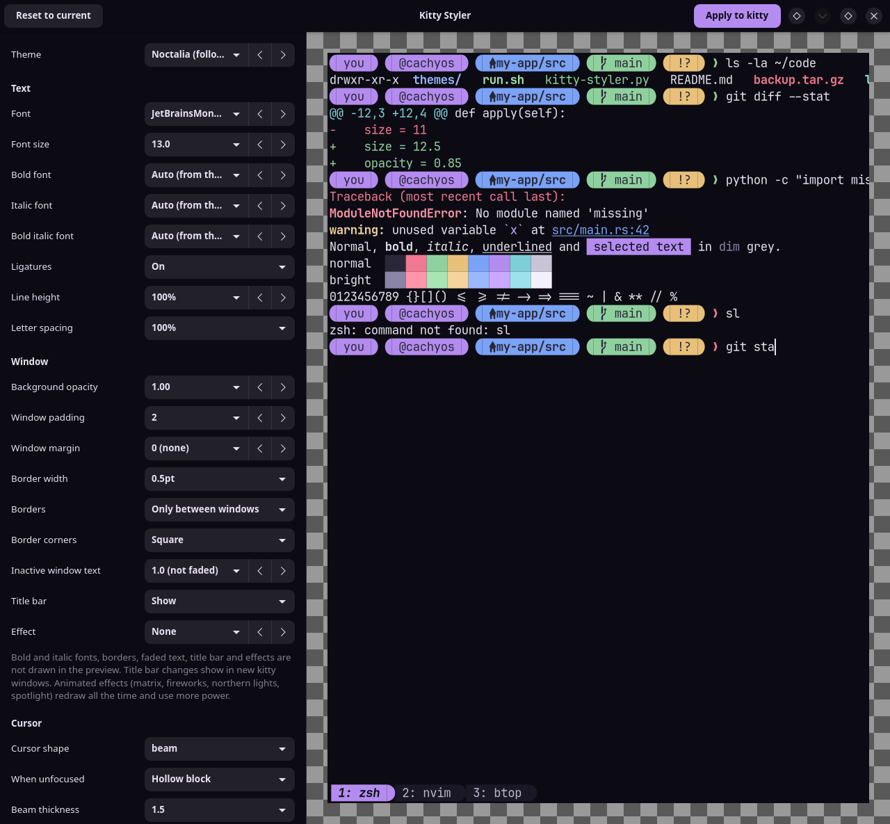

# Kitty Styler

A small GTK4 app for picking how the [kitty](https://sw.kovidgoyal.net/kitty/) terminal looks: theme, font,
opacity, padding, cursor, line height, tab bar, your prompt (your own, or a [starship](https://starship.rs/)
prompt styled here) and, with zsh, the shell itself (oh-my-zsh plugins, typing colours, behaviour).
Every change shows up in a live preview before anything is written.



## Features

- **Themes**: all of kitty's own theme collection, with a search box and previous/next buttons.
- **Kitty settings**: font, size, background opacity, window padding, cursor shape, blink and trail, line
  height, letter spacing, and tab bar position, alignment and style.
- **Live preview**: a mock terminal with a prompt, `ls`, a diff, an error, all 16 colours and the tab bar,
  drawn on your wallpaper when it can find one, so opacity is visible. The prompt is your real one: the
  app asks your shell (or starship) to draw it in the background, so Powerlevel10k, oh-my-zsh themes,
  fish and bash prompts show as they really look, including the error state.
- **Prompt**: keep your own prompt, switch the shell to starship with your own `starship.toml`, or style
  starship here: segment styles (plain, bubbles, arrows, slanted, blocks), one or two lines, and per-part
  colours for the OS icon, user and host, folder, git, error code, duration, language versions and clock.
- **Works with the shell kitty starts**: kitty's `shell` setting, else your login shell. zsh, fish and
  bash are supported; the app edits that shell's own config file.
- **Shell (zsh, optional)**: tick [oh-my-zsh](https://ohmyz.sh/) plugins from a searchable list that
  shows what each one does and the aliases it adds; pick the colours
  [zsh-syntax-highlighting](https://github.com/zsh-users/zsh-syntax-highlighting) and
  [zsh-autosuggestions](https://github.com/zsh-users/zsh-autosuggestions) use while you type; and set
  completion case, typo correction, auto cd, history size, shared history and the terminal beep. Every
  option starts at "Leave as is". Rows only show for the parts your shell actually loads.
- **Noctalia (optional)**: if [Noctalia](https://github.com/noctalia-dev/noctalia) manages your kitty
  colours, the first theme entry follows its wallpaper colours, and the app works alongside Noctalia's
  templates.

## What it changes

- **kitty.conf**: settings already in the file are edited in place. New ones go into a block at the end,
  between `# BEGIN_KITTY_STYLER` and `# END_KITTY_STYLER`. That block is rebuilt on every Apply, so put
  your own settings outside it. Open kitty windows reload straight away.
- **Theme**: a picked theme is saved to `themes/kitty-styler.conf` next to kitty.conf and included from the
  block. Pick "Keep current theme" to drop it and go back to your own colours.
- **Backups**: before each Apply, kitty.conf is copied to `kitty.conf.bak-<date>-<time>`. The newest 5 are
  kept.
- **starship.toml**: untouched unless you pick "Starship, styled here". Then Apply writes a block between
  `# >>> KITTY STYLER PROMPT >>>` markers and makes a one-time backup, `starship.toml.bak-kitty-styler`.
  If your own config already sets the same things (for example a top-level `format` or a `[directory]`
  table), nothing is written and the window says why. Picking another prompt and applying removes the
  block again. Your prompt settings stay saved in one comment line.
- **Shell config (.zshrc, config.fish or .bashrc)**: untouched while you keep your own prompt. If your
  shell doesn't start starship yet and you pick a starship prompt, Apply adds a block between
  `# >>> KITTY STYLER PROMPT SWITCH >>>` markers at the end that starts starship. For zsh, a second block
  at the top turns off Powerlevel10k's instant prompt. A one-time `.bak-kitty-styler` backup is made and
  the result is syntax-checked first. Picking your own prompt again removes the blocks, so the file is
  as it was. The blocks skip themselves when `KITTY_STYLER_BASE_PROMPT` is set; the preview uses that to
  draw your own prompt.

- **.zshrc**: untouched while every shell option is "Leave as is" and the plugin list is unchanged.
  Otherwise Apply writes the plugin list between `# >>> KITTY STYLER ZSH PLUGINS >>>` markers just before
  the line that loads oh-my-zsh, and the other settings between `# >>> KITTY STYLER ZSH >>>` markers at the
  end. It makes a one-time backup, `.zshrc.bak-kitty-styler`, and checks the result with `zsh -n` first.
  Changes apply in new shells (or `exec zsh`). Setting everything back removes both blocks.

Symlinked config files (from a dotfile manager) are written through the link.

## Requirements

- Linux with Python 3.11 or newer
- GTK 4, PyGObject and pycairo (Arch: `python-gobject python-cairo gtk4`; Debian/Ubuntu:
  `python3-gi python3-gi-cairo gir1.2-gtk-4.0`)
- fontconfig (`fc-list`), for the font list
- kitty
- zsh, fish or bash
- Optional: zsh with oh-my-zsh, zsh-syntax-highlighting and zsh-autosuggestions
- Optional: starship, and a [Nerd Font](https://www.nerdfonts.com/) for the prompt icons

The themes come from kitty's own theme collection. If the list is empty, run `kitty +kitten themes` once and
press Esc to quit it: kitty downloads the collection into `~/.cache/kitty/kitty-themes.zip`. Then press
"Reload themes".

## Install

```sh
curl -fsSL https://raw.githubusercontent.com/Soulmanyes/kitty-styler/main/install.sh | sh
```

This copies the app to `~/.local/share/kitty-styler`, adds **Kitty Styler** to your app menu and a
`kitty-styler` command to `~/.local/bin`. Run the same command again to update. Or clone the repository
and run the script from it:

```sh
git clone https://github.com/Soulmanyes/kitty-styler.git
cd kitty-styler
./install.sh
```

You can also run it straight from the clone, without installing: `python3 kitty-styler.py`.

To remove it (your kitty config stays as it is):

```sh
curl -fsSL https://raw.githubusercontent.com/Soulmanyes/kitty-styler/main/install.sh | sh -s -- --uninstall
```

## Testing on copies

These environment variables point the app at other files, so you can try it without touching your real
config:

| Variable | Default |
| --- | --- |
| `KITTY_STYLER_DIR` | `~/.config/kitty` |
| `KITTY_STYLER_STARSHIP` | `$STARSHIP_CONFIG`, else `~/.config/starship.toml` |
| `KITTY_STYLER_NOCTALIA` | `~/.local/state/noctalia/settings.toml` |
| `KITTY_STYLER_THEMES` | `~/.cache/kitty/kitty-themes.zip` |
| `KITTY_STYLER_ZSHRC` | `$ZDOTDIR/.zshrc`, else `~/.zshrc` |
| `KITTY_STYLER_FISHRC` | `$XDG_CONFIG_HOME/fish/config.fish`, else `~/.config/fish/config.fish` |
| `KITTY_STYLER_BASHRC` | `~/.bashrc` |
| `KITTY_STYLER_SHELL` | the shell kitty starts (`zsh`, `fish` or `bash`) |

Apply still sends a reload signal to every running kitty. The prompt preview runs your real shell and
reads its real config; it never writes to it.

## Tested on

CachyOS with Hyprland, kitty, starship 1.26, Noctalia and zsh 5.9 with CachyOS's oh-my-zsh setup, plus test setups without Noctalia and without a
kitty config. Prompt preview and switching tested with Powerlevel10k (one- and two-line presets),
CachyOS's fish 4.9 prompt and bash. fish's Tide prompt is not tested.

## License

[CC0 1.0](LICENSE): no rights reserved. Themes are not included; they are read from kitty's own download at
runtime. oh-my-zsh plugin descriptions and aliases are read from your own oh-my-zsh install, never bundled.
